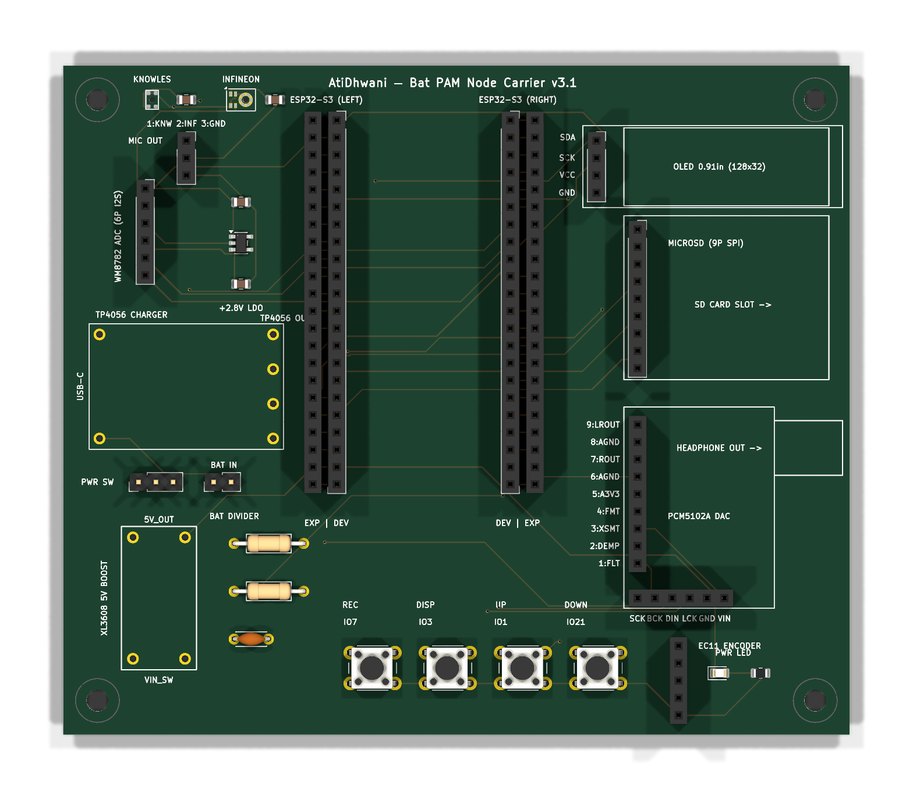
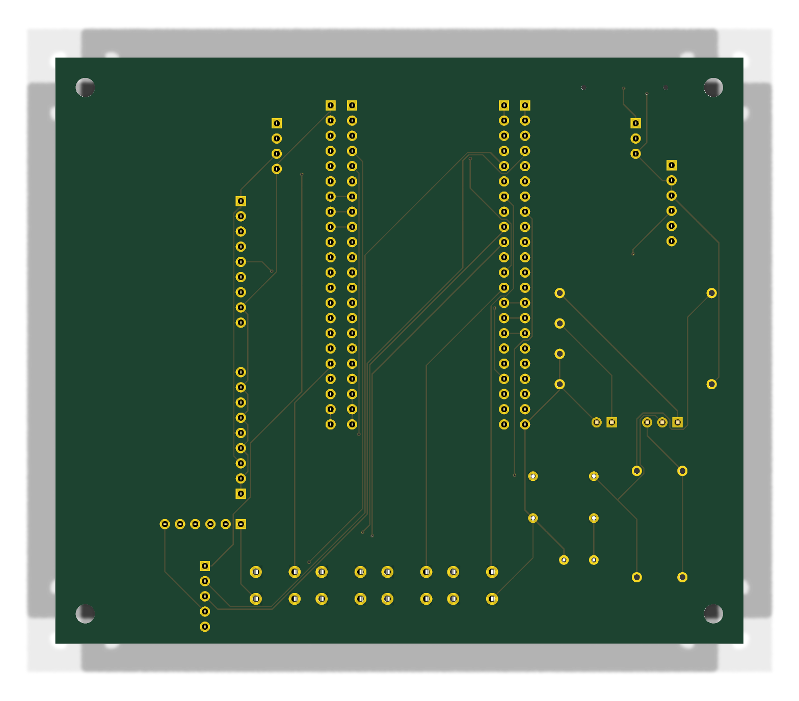
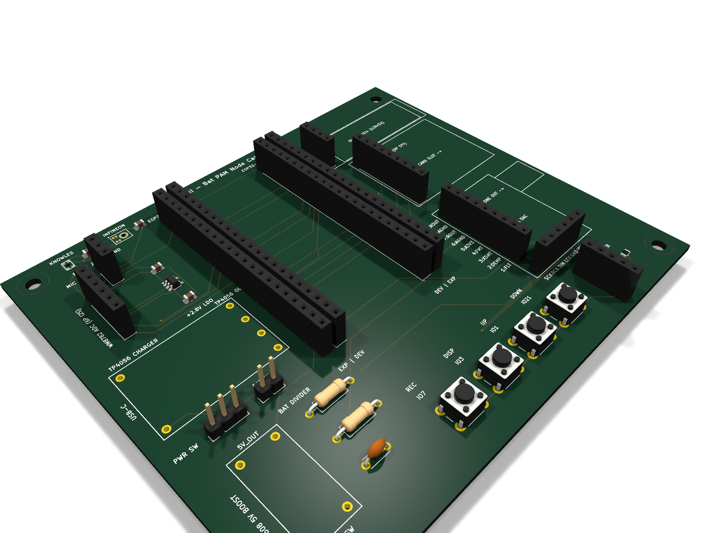
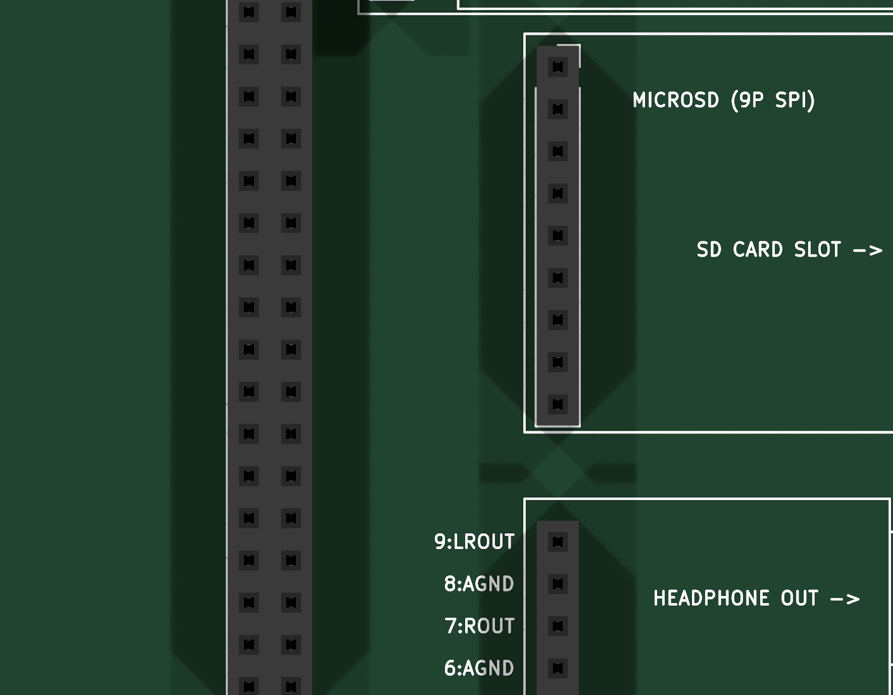
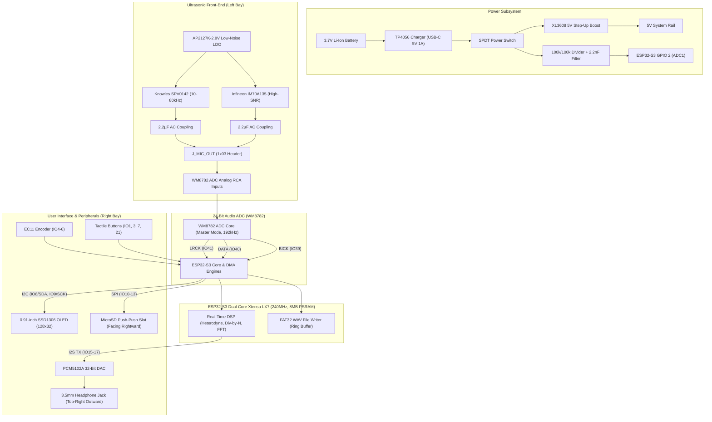

# AtiDhwani — ESP32-S3 Passive Acoustic Monitoring (PAM) Node & Ultrasonic Bat Detector

[](LICENSE)
[](hardware/kicad/)
[-brightgreen.svg)](hardware/)
[](firmware/)
[](docs/ARCHITECTURE.md)

**AtiDhwani** (*अतिध्वनि* — *Sanskrit for Ultrasound / Supersonic sound*) is an open-source, high-performance, modular **Passive Acoustic Monitoring (PAM)** hardware node and handheld bat detector. 

Designed for wildlife ecologists, bioacoustic researchers, conservationists, and field naturalists, AtiDhwani captures, records, and transforms ultrasonic echolocation calls from microbats and orthopterans in the **10 kHz to 96 kHz** frequency spectrum in real time.

---

## Visual Preview (Hardware Revision v3.2 — Fully Routed)

| Top View (Routed Traces) | Bottom Layer (Power & Ground Pours) |
| :---: | :---: |
|  |  |

| 3D Perspective (Complete Board) | Outward Ports (Jack & MicroSD) |
| :---: | :---: |
|  |  |

---

## 1. Why AtiDhwani?

Commercial ultrasonic bat detectors and long-term acoustic loggers (such as the Song Meter SM4BAT, Pettersson D1000X, or Wildlife Acoustics Echo Meter Touch) cost anywhere from **$300 to $3,500 USD**. Low-cost DIY alternatives often suffer from high noise floors, limited sampling bandwidth, or lack of direct real-time auditory feedback in the field.

**AtiDhwani bridges this gap:**
* **BOM Cost Under $40 USD:** Built entirely using readily available commodity modules, surface-mount MEMS transducers, and standard 2-layer FR-4 fabrication.
* **True 192 kHz 24-Bit Ultrasonic Capture:** External Wolfson WM8782 stereo ADC operating in hardware Master Mode with dedicated 24.576 MHz crystal oscillator.
* **Real-Time Heterodyne Listening:** Tunable local oscillator ($15\text{ kHz} - 90\text{ kHz}$) mixed directly in DSP, down-converting ultrasound to human-audible frequencies with zero latency.
* **Dual-Microphone Front-End:** Dual wideband MEMS sensors (Knowles SPV0142 and Infineon IM70A135) powered by an ultra-low-noise 2.8V linear regulator.
* **Field-Ready 3D Enclosure Alignment (v3.1):** 
  * MicroSD card slot opens directly outward to the right edge.
  * 3.5mm stereo headphone jack oriented towards the upper-right board perimeter.
  * 0.91" OLED display mounted vertically, remaining 100% enclosed within the PCB boundary.
  * Stand-mounted TP4056 USB-C charger and XL3608 5V boost converter.

---

## 2. Key Specifications

| Subsystem | Specification |
| :--- | :--- |
| **Acoustic Range** | **10 kHz to 96 kHz** (Nyquist limit at 192 kHz sampling rate) |
| **Microphones** | Knowles SPV0142LR5H-1 ($10 - 80+\text{ kHz}$) + Infineon IM70A135 ($70\text{ dB(A)}$ SNR) |
| **Microphone Supply** | AP2127K-2.8 Ultra-Low-Noise LDO ($2.8\text{ V}$, high PSRR) |
| **Audio ADC** | Wolfson / Cirrus Logic WM8782 (24-bit, 192 kHz stereo, Master Clocked) |
| **Compute Engine** | ESP32-S3 Dual-Core Xtensa LX7 @ 240 MHz + **8MB Octal PSRAM (N16R8)** |
| **Audio DAC** | TI / Burr-Brown PCM5102A (32-bit, integrated charge pump, $2.1\text{ V}_{\text{RMS}}$ line/headphone out) |
| **Audio Outputs** | 3.5mm stereo headphone jack + duplicate expansion header pins |
| **Storage** | MicroSD slot (FAT32 filesystem, sustained DMA WAV logging up to 192 kHz) |
| **Display** | 0.91" 128×32 SSD1306 OLED (I2C at 400 kHz) |
| **User Controls** | 1× EC11 rotary encoder with push switch + 4× tactile buttons (Record, Display, Freq UP, Freq DOWN) |
| **Power Supply** | Single-cell 3.7V Li-Ion / 18650 battery via 2-pin JST-PH or header |
| **Charging & Boost** | On-board sockets for TP4056 (USB-C 1A) and XL3608 5V step-up boost module |
| **Telemetry** | Integrated 1:2 battery voltage divider ($100\text{ k}\Omega / 100\text{ k}\Omega \pm 1\%$) with $2.2\text{ nF}$ filter on GPIO2 |
| **PCB Dimensions** | $120.0\text{ mm} \times 106.0\text{ mm}$ (2-layer FR-4, 1.6 mm thickness, 1 oz Cu) |

---

## 3. System Architecture



---

## 4. Repository Structure

```text
├── assets/                  # High-resolution 3D CAD renders and photos
│   └── renders/             # Carrier top, iso, DAC zoom, and edge zoom images
├── docs/                    # In-depth engineering specifications
│   ├── ARCHITECTURE.md      # Full signal path, power tree, and DSP design
│   ├── PINOUT_REFERENCE.md  # Complete 44-pin ESP32-S3 and header netlist mapping
│   ├── ENCLOSURE_GUIDE.md   # Dimensions, port cutouts, and 3D printing clearances
│   ├── HARDWARE_AUDIT.md    # DRC logs, trace impedance, and layout revisions
│   └── datasheets/          # Sensor and component reference datasheets
├── firmware/                # Production embedded C++ firmware
│   ├── src/                 # Arduino sketch, DSP engines, and web companion
│   └── README.md            # Board setup, compiler flags, and flashing guide
├── hardware/                # KiCad 10 project and manufacturing files
│   ├── kicad/               # Schematics, PCB layout, and design rules
│   ├── gerbers/             # Fabrication zip, Gerber files, and NC drills
│   ├── schematic/           # Vector PDF schematic and high-res diagram
│   ├── bom/                 # Human-readable & CSV Bill of Materials
│   └── README.md            # PCB specs, layer stackup, and ordering guide
├── tests/                   # Modular hardware verification sketches
│   ├── test_01_esp32_psram/ # PSRAM throughput and memory test
│   ├── test_02_oled/        # I2C display test
│   ├── test_03_rotary_encoder/ # Quadrature encoder test
│   ├── test_04_buttons/     # Debounced button test
│   ├── test_05_sd_card/     # MicroSD SPI read/write speed test
│   ├── test_06_wm8782_adc/  # 192 kHz ADC I2S capture test
│   ├── test_07_pcm5102_dac/ # 48 kHz DAC I2S audio sweep test
│   ├── test_08_integrated_ui_sd/ # UI + SD card event logging
│   ├── test_esp32_ultrasonic_generator/ # 35-100 kHz PWM signal generator
│   ├── test_full_system_adc_dac_sd/     # End-to-end loopback test
│   ├── test_layer1_full_check/          # Comprehensive bus self-test
│   └── test_audio_samples/  # Real bat recordings and synthetic test chirps
├── .gitignore               # Clean git exclusion rules
├── LICENSE                  # MIT Open Source License
└── README.md                # Top-level repository overview (this document)
```

---

## 5. Getting Started

### 1. Order PCBs
Download the ready-to-fabricate gerber package from `hardware/gerbers/Esperdyne_Motherboard_Gerbers_v3.1.zip` and submit to your preferred PCB fabricator (JLCPCB, PCBWay, OSH Park).

### 2. Procure Components
Refer to [hardware/bom/BOM.md](hardware/bom/BOM.md) for the complete list of parts, module breakouts, and passives.

### 3. Flash Firmware
1. Open `firmware/src/Esperdyne_Full_Firmware.ino` in Arduino IDE or PlatformIO.
2. Select **ESP32S3 Dev Module** with **OPI PSRAM Enabled** and **USB CDC on Boot Enabled**.
3. Compile and flash via the USB Type-C port on the ESP32-S3 module.

### 4. Hardware Bring-Up
Follow the step-by-step verification guide in [tests/README.md](tests/README.md) using the standalone verification sketches (`test_01` through `test_08`).

---

## 6. Enclosure & 3D Printing

Revision v3.1 features optimized component orientations for seamless integration into custom 3D printed enclosures:
* **Headphone Jack:** Standard 3.5mm stereo jack accessible from the upper-right perimeter.
* **MicroSD Card:** Accessible from the right-hand side wall.
* **Power Switch & USB-C:** Power slide switch and TP4056 charging port accessible along the left perimeter.
* **Mounting:** 4× M3 corner mounting holes (hole centers at 5.0 mm inset).
* For detailed enclosure dimensions and cutout offsets, see [docs/ENCLOSURE_GUIDE.md](docs/ENCLOSURE_GUIDE.md).

---

## 7. License

This project is licensed under the **MIT License** — see the [LICENSE](LICENSE) file for details. You are free to build, modify, distribute, and commercialize this hardware and software.
