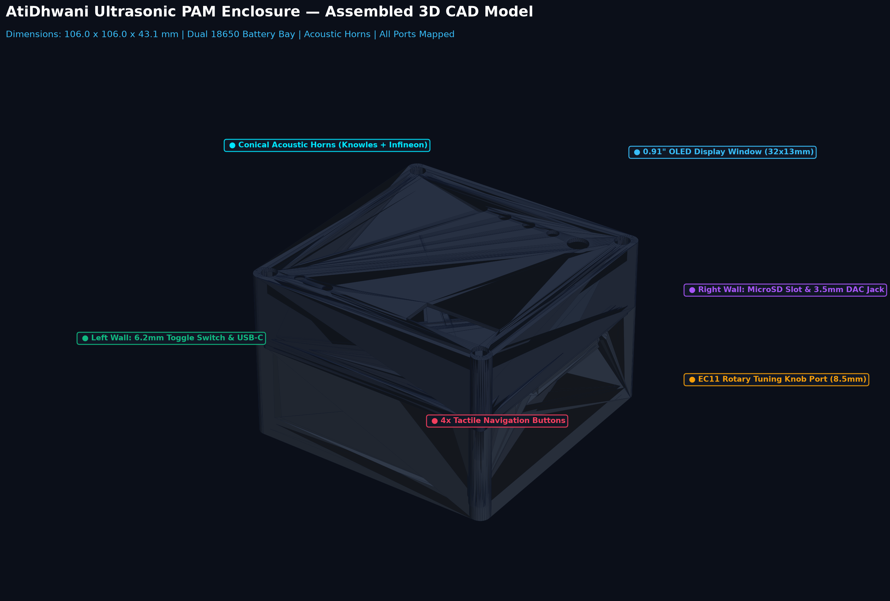
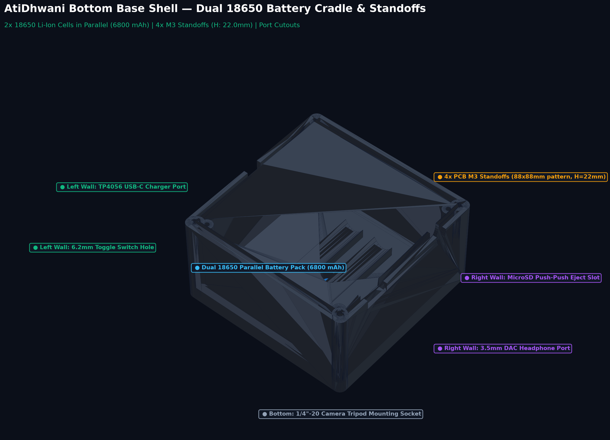
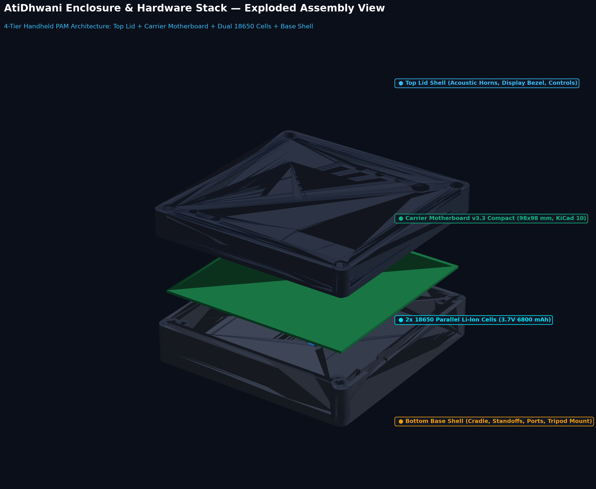

# 3D Enclosure Mechanical Integration Guide — AtiDhwani Bat PAM Node (Revision v3.3 Compact)

The AtiDhwani carrier motherboard (**Revision v3.3 Compact**) measures strictly **98.0 mm × 98.0 mm** and has been engineered for seamless integration into a handheld, field-deployable 3D-printed enclosure featuring an integrated **Dual 18650 parallel battery compartment (6800 mAh)**, panel-mount toggle switch port, and acoustic horn apertures.

Ready-to-print binary STL files and parametric OpenSCAD source are provided in [`hardware/enclosure/`](../hardware/enclosure/):
* `AtiDhwani_Enclosure_Bottom_Base.stl` (Base shell with dual 18650 cradle, 22mm standoffs, port cutouts, and 1/4"-20 tripod nut trap)
* `AtiDhwani_Enclosure_Top_Lid.stl` (Top lid with conical ultrasonic horns, 0.91" OLED window, encoder shaft, and button ports)
* `AtiDhwani_Enclosure_v3.3.scad` (Fully parametric OpenSCAD source code)

---

## Visual Previews

| Assembled 3D CAD Enclosure | Base Shell Interior & Dual 18650 Cradle |
| :---: | :---: |
|  |  |

| Exploded 4-Tier Hardware Assembly |
| :---: |
|  |

---

## 1. Enclosure Shell Specifications

| Parameter | Specification | Notes |
| :--- | :--- | :--- |
| **Outer Dimensions** | **106.0 mm × 106.0 mm × 43.1 mm** | Handheld, pocket-sized field form factor |
| **Inner Cavity** | $101.0\text{ mm} \times 101.0\text{ mm}$ ($1.5\text{ mm}$ clearance on all sides) | Easily clears PCB and overhanging perimeter modules |
| **Wall Thickness** | $2.5\text{ mm}$ (Base & Lid) | High rigidity and impact resistance for outdoor field ecology |
| **Interlocking Joint** | $2.0\text{ mm}$ step lip around perimeter | Seals against dust, rain spray, and light debris |
| **Battery Bay** | Dual 18650 parallel cradle ($18.5\text{ mm}$ dia, $68.0\text{ mm}$ len) | Located on floor of base beneath the PCB ($>24\text{ hours}$ runtime) |
| **PCB Standoff Height** | **22.0 mm** from base floor to PCB underside | Clears dual 18650 pack and through-hole solder pins |
| **Fasteners** | 4× M3 × 12mm socket head cap screws (Lid) + 4× M3 × 6mm (PCB) | Brass heat-set inserts (Ruthex M3×5.7) or self-tapping screws |
| **Tripod Mount** | Standard 1/4"-20 brass camera tripod nut trap | Molded into base floor for unattended tree/tripod field logging |

---

## 2. PCB Mounting Standoffs (Base Shell)

* **Mounting Pattern:** 4× M3 standoffs on a symmetrical **88.0 mm × 88.0 mm** square grid:
  * **Top-Left (H1):** `(-44.0 mm, -44.0 mm)`
  * **Top-Right (H2):** `(+44.0 mm, -44.0 mm)`
  * **Bottom-Left (H3):** `(-44.0 mm, +44.0 mm)`
  * **Bottom-Right (H4):** `(+44.0 mm, +44.0 mm)`
* **Standoff Dimensions:** Outer diameter $7.0\text{ mm}$, pilot hole diameter $2.8\text{ mm}$ ($10\text{ mm}$ deep).

---

## 3. Left Wall Port Cutouts (Power Bay)

| Control / Port | Subsystem | Position (Relative to Center) | Cutout Dimensions | Purpose |
| :--- | :--- | :---: | :---: | :--- |
| **Panel Toggle Switch** | Heavy-duty Power Switch | $Y = +15.0\text{ mm}, Z = 12.5\text{ mm}$ | $6.2\text{ mm}$ diameter circular hole | Standard MTS-102 / MTS-103 miniature toggle switch |
| **USB-C Charging Slot** | TP4056 Charger | $Y = 0.0\text{ mm}, Z = 24.5\text{ mm}$ | $10.0\text{ mm} \times 4.5\text{ mm}$ rounded slot | Connect standard USB-C cable to recharge 18650s |

---

## 4. Right Wall Port Cutouts (Peripherals)

| Port | Subsystem | Position (Relative to Center) | Cutout Dimensions | Purpose |
| :--- | :--- | :---: | :---: | :--- |
| **MicroSD Card Slot** | MicroSD SPI Breakout | $Y = -25.0\text{ mm}, Z = 24.5\text{ mm}$ | $15.0\text{ mm} \times 3.5\text{ mm}$ slot | Push-push card insertion and removal without opening case |
| **3.5mm Headphone Jack** | PCM5102A DAC Output | $Y = +26.5\text{ mm}, Z = 25.5\text{ mm}$ | $7.5\text{ mm}$ diameter circular hole | Real-time heterodyne bat listening with standard headphones |

---

## 5. Top Lid Cutouts & Acoustic Horns

1. **Dual Ultrasonic Acoustic Horn Apertures:**
   * **Knowles SPV0142 Horn:** Centered at `X = -36.0 mm, Y = -44.0 mm`. Internal aperture dia $3.5\text{ mm}$, flaring outward to a conical horn of dia $6.5\text{ mm}$.
   * **Infineon IM70A Horn:** Centered at `X = -23.0 mm, Y = -44.0 mm`. Internal aperture dia $3.5\text{ mm}$, flaring outward to a conical horn of dia $6.5\text{ mm}$.
   * *Acoustic Protection:* Underside of lid features a $12\text{ mm} \times 28\text{ mm} \times 1.0\text{ mm}$ recess for a protective hydrophobic acoustic membrane (Gore-Tex acoustic vent or 200-mesh stainless steel) that blocks water droplets while preserving $>95\%$ ultrasonic transmission up to $96\text{ kHz}$.
2. **0.91" OLED Display Viewing Window:**
   * Centered at `X = +29.0 mm, Y = -38.0 mm`.
   * Cutout Size: $32.0\text{ mm} \times 13.0\text{ mm}$ with internal step for $1.0\text{ mm}$ transparent acrylic sheet.
3. **EC11 Rotary Tuning Knob Shaft Port:**
   * Centered at `X = +35.0 mm, Y = +36.0 mm`.
   * Cutout Size: $8.5\text{ mm}$ circular opening for encoder threaded bushing and knob rotation.
4. **4× Tactile Navigation Button Ports:**
   * Located along `Y = +37.0 mm`:
     * `SW1` (Record): `X = -10.0 mm` ($5.0\text{ mm}$ dia)
     * `SW2` (Display Mode): `X = +1.0 mm` ($5.0\text{ mm}$ dia)
     * `SW3` (Frequency UP): `X = +12.0 mm` ($5.0\text{ mm}$ dia)
     * `SW4` (Frequency DOWN): `X = +23.0 mm` ($5.0\text{ mm}$ dia)

---

## 6. 3D Printing Recommendations

* **Recommended Filament:** PETG, ABS, or ASA (PLA is fine for prototyping, but PETG/ASA offers superior UV and heat resistance in direct sunlight field conditions).
* **Layer Height:** $0.20\text{ mm}$ standard ($0.16\text{ mm}$ for fine acoustic horn resolution).
* **Infill:** $25\% - 35\%$ Gyroid or Grid for rigidity.
* **Wall Count:** 4 perimeters (1.6 mm shell thickness) ensures water-resistance and solid screw threads.
* **Print Orientation:**
  * **Base Shell:** Print upright with the bottom face flat on the build plate (zero supports needed for standoffs; gentle tree supports recommended for wall cutouts).
  * **Top Lid:** Print upside down (exterior top face flat on the build plate) for smooth surface finish and support-free printing.
