# AtiDhwani Bat PAM Node Carrier Motherboard — Hardware Audit v3.1

> [!IMPORTANT]
> **Revision v3.1 Mechanical & Enclosure Optimization:**
> This revision corrects the physical GY-PCM5102 DAC breakout board orientation based on real hardware geometry:
> 1. **180° Rotated DAC Layout (`J_DAC1` & `J_DAC2`):**
>    * **6-Pin Header (`J_DAC1`):** Positioned horizontally along the **BOTTOM** row at `y = 178.00 mm` (`x = 184.00` to `196.70 mm`, `rot = 90`).
>    * **9-Pin Header (`J_DAC2`):** Positioned vertically along the **LEFT** column at `x = 184.00 mm`, running **UPWARDS** from `y = 172.92 mm` to `152.60 mm` (`rot = 180`).
>    * **Exact 5.08mm Corner Gap:** Preserved between `SCK` (`J_DAC1.1` at `184.0, 178.0`) and `FLT` (`J_DAC2.1` at `184.0, 172.92`) at the bottom-left corner.
>    * **Top-Right Outward Headphone Jack:** The 3.5mm stereo headphone jack sits at the **TOP-RIGHT** of the DAC footprint (`x ≈ 213.5 mm`, `y ≈ 152.0 - 160.0 mm`), opening directly outward through the right enclosure wall!
> 2. **Vertical 1x04 OLED Socket (`J_OLED1`):** Rotated by 90° (`rot = 0` at `x = 174.0 mm, y = 111.0 mm`), matching the physical 0.91" SSD1306 OLED breakout board where pins are aligned along the short 12mm edge.
> 3. **Outward-Facing MicroSD Slot (`J_SPI1`):** Vertical 1x09 socket at `x = 184.0 mm` with push-push card slot facing the right enclosure wall.
> 
> **Zero DRC Violations:** Verified with KiCad 10 with **0 errors and 0 courtyard overlaps**.

---

## 1. Product Enclosure Interface Architecture

```mermaid
flowchart LR
    subgraph LeftEdge["Left Board Edge (Power & Audio Inputs)"]
        USBC["USB-C Receptacle (TP4056 5V 1A)"]
        SW["SPDT Power Switch (PWR SW)"]
        MIC_OUT["J_MIC_OUT (Direct to WM8782 RCA)"]
    end

    subgraph Center["Core Processing & Expansion"]
        ESP["ESP32-S3 DevKitC-1 Sockets"]
        EXP["Dual Parallel Expansion Headers (100% Pin Access)"]
    end

    subgraph RightEdge["Right Board Edge (User Interface & External Ports)"]
        OLED["0.91-inch OLED (Vertical 1x04 Socket, 100% Enclosed)"]
        SD["MicroSD Slot (Faces Right Wall Outward)"]
        DAC["PCM5102A DAC (Headphone Jack at Top-Right Outward)"]
        ENC["EC11 Rotary Encoder (Bottom Right)"]
    end

    LeftEdge <--> Center <--> RightEdge
```



---

## 2. Right Bay Component Orientations & Pinouts (v3.1)

### A. GY-PCM5102 Audio DAC (`J_DAC1` + `J_DAC2`) — Top-Right Outward Headphone Jack
* **Physical Mounting:**
  * **Bottom Header `J_DAC1` (1x06 Horizontal along bottom):** At `y = 178.00 mm`, running from `x = 184.00 mm` to `x = 196.70 mm` (`rot = 90`).
  * **Left Header `J_DAC2` (1x09 Vertical along left):** At `x = 184.00 mm`, running UPWARDS from `y = 172.92 mm` to `y = 152.60 mm` (`rot = 180`).
  * **Physical Spacing:** Exact 5.08mm (2-pitch) offset between `SCK` (`J_DAC1.1` at `184.0, 178.0`) and `FLT` (`J_DAC2.1` at `184.0, 172.92`) at the bottom-left corner.
* **Headphone Jack Position:** The 3.5mm stereo headphone jack barrel is located at the **TOP-RIGHT** of the DAC footprint (`x ≈ 213.5 mm`, `y ≈ 152.0 - 160.0 mm`), opening directly through the right wall of the 3D-printed enclosure.
* **Pinout & Hardware Strapping:**
  * **Bottom Header `J_DAC1` (Left to Right):**
    * `J_DAC1.1 (x=184.00)`: `SCK` $\rightarrow$ `GND` (**Internal PLL Clock Active**)
    * `J_DAC1.2 (x=186.54)`: `BCK` $\rightarrow$ `GPIO 15` (Bit Clock)
    * `J_DAC1.3 (x=189.08)`: `DIN` $\rightarrow$ `GPIO 16` (Serial Data)
    * `J_DAC1.4 (x=191.62)`: `LCK` $\rightarrow$ `GPIO 17` (Word Select / WS)
    * `J_DAC1.5 (x=194.16)`: `GND` $\rightarrow$ `GND`
    * `J_DAC1.6 (x=196.70)`: `VIN` $\rightarrow$ `+3.3V`
  * **Left Header `J_DAC2` (Bottom to Top):**
    * `J_DAC2.1 (y=172.92)`: `FLT` $\rightarrow$ `GND` (Normal latency filter)
    * `J_DAC2.2 (y=170.38)`: `DEMP` $\rightarrow$ `GND` (De-emphasis OFF)
    * `J_DAC2.3 (y=167.84)`: `XSMT` $\rightarrow$ `+3.3V` (**Active Soft Un-Mute**, no silence bug)
    * `J_DAC2.4 (y=165.30)`: `FMT` $\rightarrow$ `GND` (Standard I2S format)
    * `J_DAC2.5 (y=162.76)`: `A3V3` $\rightarrow$ `+3.3V` (Analog core power)
    * `J_DAC2.6 (y=160.22)`: `AGND` $\rightarrow$ `GND`
    * `J_DAC2.7 (y=157.68)`: `ROUT` $\rightarrow$ `DAC_ROUT` (Right analog line out)
    * `J_DAC2.8 (y=155.14)`: `AGND` $\rightarrow$ `GND`
    * `J_DAC2.9 (y=152.60)`: `LROUT` $\rightarrow$ `DAC_LOUT` (Left analog line out)

---

### B. 0.91" I2C OLED Display (`J_OLED1`) — Vertical 1x04 Socket
* **Physical Mounting:** Vertical 1x04 socket at `x = 174.0 mm, y = 111.0 mm` (`rot = 0`).
* **Dimensions:** 38.0mm × 12.0mm module body; 30.0mm × 11.4mm active glass screen.
* **Perimeter Verification:** Sits from `x = 172.0 mm` to `x = 210.0 mm`, `y = 108.8 mm` to `y = 120.8 mm`. Minimum 5.0mm internal border to board edge (`x1 = 215.0 mm`) and completely clear of mounting hole `H2` (`y = 105.0 mm`).
* **Pinout (Top to Bottom):**
  * **Pin 1 (`y=111.00`):** `SDA` $\rightarrow$ `GPIO 8` (`PIN_OLED_SDA`)
  * **Pin 2 (`y=113.54`):** `SCK` $\rightarrow$ `GPIO 9` (`PIN_OLED_SCL`)
  * **Pin 3 (`y=116.08`):** `VCC` $\rightarrow$ `+3.3V`
  * **Pin 4 (`y=118.62`):** `GND` $\rightarrow$ System Ground

---

### C. MicroSD SPI Breakout (`J_SPI1`) — Outward-Facing Card Slot
* **Physical Mounting:** Vertical 1x09 socket at `x = 184.0 mm`, running from `y = 124.0 mm` to `y = 144.32 mm`.
* **Direction:** Push-push MicroSD card slot sits at `x ≈ 212.5 mm`, directly adjacent to the board right edge (`x1 = 215.0 mm`).
* **Pinout:**
  * `1: +3.3V`, `2: NC`, `3: SCK (IO12)`, `4: MOSI (IO11)`, `5: MISO (IO13)`, `6: CS (IO10)`, `7: NC`, `8: GND`, `9: NC`.

---

### D. EC11 Rotary Encoder (`J_ENC1`) & Status LED
* **Physical Mounting:** Vertical 1x05 socket at `x = 190.0 mm, y = 185.0 mm`.
* **Clearance:** 15.0mm horizontal clearance to tactile button `SW4` (`x = 175.0 mm`), zero courtyard overlap.
* **Pinout:** `1: IO6 (CLK)`, `2: IO5 (DT)`, `3: IO4 (SW)`, `4: +3.3V`, `5: GND`.

---

## 3. 3D Raytraced Verification Renders (Revision v3.1)

````carousel

<!-- slide -->

<!-- slide -->

<!-- slide -->

<!-- slide -->

````

---

## 4. Production Deliverables & Files

* **Master KiCad Project Archive for Editor:** [`Esperdyne_Motherboard_v3.1_KiCad_Project_For_Editor.zip`](file:///c:/Users/sansh/Downloads/EsperdyneBATkonnect/Esperdyne_Motherboard_v3.1_KiCad_Project_For_Editor.zip)
* **Manufacturing Gerbers Package:** [`Esperdyne_Motherboard_Gerbers_v3.1.zip`](file:///c:/Users/sansh/Downloads/EsperdyneBATkonnect/Esperdyne_Motherboard_Gerbers_v3.1.zip)
* **Master Vector Schematic (PDF):** [`Esperdyne_Schematic_v3.1.pdf`](file:///c:/Users/sansh/Downloads/EsperdyneBATkonnect/Esperdyne_Schematic_v3.1.pdf)
* **KiCad PCB File:** [`Esperdyne_Motherboard.kicad_pcb`](file:///c:/Users/sansh/Downloads/EsperdyneBATkonnect/Esperdyne_PCB_Carrier/Esperdyne_Motherboard.kicad_pcb)
* **KiCad Schematic File:** [`Esperdyne_Motherboard.kicad_sch`](file:///c:/Users/sansh/Downloads/EsperdyneBATkonnect/Esperdyne_PCB_Carrier/Esperdyne_Motherboard.kicad_sch)
* **KiCad DRC Report:** [`drc_report_v31.txt`](file:///c:/Users/sansh/Downloads/EsperdyneBATkonnect/drc_report_v31.txt) (0 Errors)
